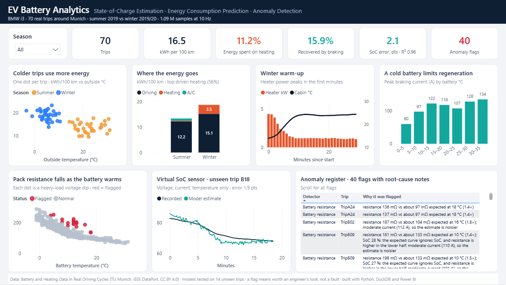
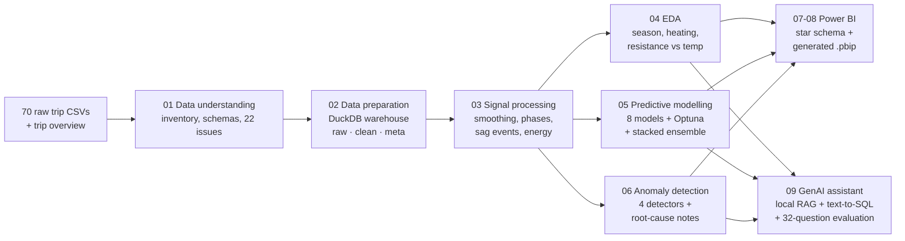

<div align="center">

# EV Battery Analytics

### State-of-Charge Estimation · Energy Consumption Prediction · Anomaly Detection

End-to-end data and AI pipeline on **70 real BMW i3 test drives**: **1.09 M samples** of battery, driving and
heating signals at 10 Hz. It turns raw vehicle logs into engineering insights, predictive models, a Power BI
dashboard and a local GenAI assistant.




</div>

## Highlights

| | Result |
|---|---|
| 🔋 **Virtual SoC sensor** | Stacked ensemble estimates state of charge from voltage, current and temperature with **2.1 % mean error (R² 0.96)** on 14 unseen trips |
| ⚡ **Energy prediction** | Predicts energy per km of a driving segment with **2.0 kWh/100 km mean error (R² 0.76)** on unseen trips |
| ❄️ **Why winter costs more** | Winter trips use **43 % more energy per km** (19.1 vs 13.3 kWh/100 km). Cabin heating takes **18 %** of winter energy, and only **about half** as much braking energy is recovered (12 % vs 23 %) |
| 🌡️ **Battery health signal** | Apparent pack resistance falls from **197 mΩ below 5 °C to 73 mΩ above 25 °C** (Spearman ρ = −0.91 over 556 voltage-sag events) |
| 🚨 **Anomaly detection** | 40 explained flags across 23 trips, from four detectors, each with a root-cause note |
| 🤖 **Local GenAI assistant** | RAG + text-to-SQL on a laptop GPU (Ollama). It refuses **100 %** of out-of-scope questions, and prompt engineering lifted accuracy from 62 % to about 70 % |
| ✅ **Trustworthy data** | 22 data-quality issues found and logged. Battery energy vs SoC used implies a **22 kWh pack**, matching the BMW i3's rated 21.6 kWh (r = 0.997) |

## The pipeline



| Step | Notebook | What it does |
|---|---|---|
| 01 | [`01_data_understanding`](notebooks/01_data_understanding.ipynb) | Checksums, file inventory, per-trip schemas, and an issue register of 22 data-quality problems |
| 02 | [`02_data_preparation`](notebooks/02_data_preparation.ipynb) | One clean schema across summer and winter logs; logged fixes; driving / stopped / charging labels; DuckDB warehouse; 10 SQL data-quality checks |
| 03 | [`03_signal_processing`](notebooks/03_signal_processing.ipynb) | Savitzky-Golay smoothing; phase segments; voltage-sag events with apparent resistance; per-trip energy, cross-checked against distance and SoC |
| 04 | [`04_eda`](notebooks/04_eda.ipynb) | Summer vs winter with Mann-Whitney tests; heating load; drivers of consumption; resistance vs temperature; correlations |
| 05 | [`05_predictive_modelling`](notebooks/05_predictive_modelling.ipynb) | 8 models (linear, tree ensembles, MLP); trip-grouped cross-validation; Optuna tuning of the top 3; stacked ensemble; interactive Plotly charts |
| 06 | [`06_anomaly_detection`](notebooks/06_anomaly_detection.ipynb) | Resistance residuals (robust z); unexpected consumption (leave-one-out); Isolation Forest; signal-quality flags |
| 07 | [`07_powerbi_export`](notebooks/07_powerbi_export.ipynb) | Star-schema export for the dashboard |
| 08 | [`08_build_powerbi_project`](notebooks/08_build_powerbi_project.ipynb) | Generates the Power BI Project (TMDL + PBIR) as code and validates it against Microsoft's JSON schemas |
| 09 | [`09_genai_assistant`](notebooks/09_genai_assistant.ipynb) | Local LLM assistant: router, cited RAG answers, read-only text-to-SQL, automated evaluation |

## Key findings

**1. Winter energy: heating and a cold battery.**
- Median consumption is 19.1 kWh/100 km in winter against 13.3 in summer.
- Cabin heating draws about 3.6 kW in the first 5 minutes and about 1.2 kW once the cabin is warm, so short winter trips are the least efficient.
- Even without heating, winter costs about 3 kWh/100 km more. Part of the reason is that a cold battery limits regenerative braking: the 99th-percentile regeneration current is about 60 A at 0–5 °C, against more than 120 A above 10 °C.

**2. Pack resistance is a temperature story.**
- Apparent resistance, computed as voltage sag divided by extra current, is close to linear physics and drops steeply as the battery warms.
- It explains why winter trips show about 6× more heavy voltage dips per 10 km.

**3. Model benchmark.**

| Task | Selected model | Test MAE | Test R² |
|---|---|---|---|
| SoC estimation (1 Hz) | Stacked ensemble (polynomial Ridge, Ridge, LightGBM, MLP, ...) | **2.12 SoC points** | **0.96** |
| Segment energy | Stacked ensemble (polynomial Ridge, MLP, Ridge, XGBoost, ...) | **1.99 kWh/100 km** | **0.76** |

- Models were selected by 5-fold GroupKFold on 56 trips and scored once on 14 locked test trips.
- Linear models led the single-model ranking for SoC: the battery physics is close to linear, and trees cannot extrapolate to unseen trips.
- Optuna tuning added only 0–3 %. The limit is the information in the signals, not the settings.

**4. Data quality is part of the result.**
- The CAN heating signal was stale in summer trips: it reported heating while none was requested.
- A 26 kW heating event in TripB02 looked like a glitch but is real. Four independent signals confirm it.
- The overview sheet's TripA30/A31 rows are wrong, so values are integrated from the signals instead.

## Tech stack

| Area | Tools |
|---|---|
| Data engineering | Python, pandas, NumPy, **DuckDB** (layered warehouse: raw / clean / signal / model / anomaly), SQL data-quality checks |
| Signal processing and statistics | SciPy (Savitzky-Golay), Mann-Whitney U, Spearman, robust z-scores |
| Machine learning | scikit-learn, **XGBoost**, **LightGBM**, MLP, **Optuna**, stacking, GroupKFold, permutation importance |
| Visualisation | **Plotly**, Matplotlib, **Power BI** (TMDL semantic model + PBIR report generated from Python, DAX measures) |
| Generative AI | **Ollama** (`gemma2:2b`, `nomic-embed-text`), RAG with citations, text-to-SQL with guardrails, LLM evaluation |

## Quick start

```bash
git clone https://github.com/lucky07-07/ev-battery-analytics.git
cd ev-battery-analytics
python -m venv .venv
.venv\Scripts\activate            # macOS/Linux: source .venv/bin/activate
pip install -r requirements.txt
python -m ipykernel install --user --name volvo --display-name "Python (volvo)"
python scripts/download_data.py   # needs a Kaggle API token in ~/.kaggle/kaggle.json
```

1. Run the notebooks in order, `01` → `09`. Steps 01–08 take about 15 minutes on a laptop, most of it the model benchmark.
2. **Step 09** needs [Ollama](https://ollama.com) with `ollama pull gemma2:2b` and `ollama pull nomic-embed-text`.
3. **Dashboard:** open `powerbi/BatteryInsights/BatteryInsights.pbip` in Power BI Desktop and click **Refresh**. If you cloned to
   another folder, rerun notebook 08 or set the `DataFolder` parameter to your `powerbi\data\` path.

## Project structure

```
├── notebooks/            01 → 09, executed with outputs
├── reports/              issue register, cleaning log, metrics, evaluation results, figures (PNG + interactive HTML)
├── powerbi/
│   ├── BatteryInsights/  Power BI Project (.pbip), generated by notebook 08
│   ├── data/             star-schema CSVs the dashboard loads
│   ├── screenshots/      rendered dashboard
│   └── tools/            PowerShell helpers to open, refresh and capture the report
├── knowledge_base/       generated trip reports and findings used by the GenAI assistant
├── scripts/              dataset download
└── requirements.txt
```

## Dataset

**Battery and Heating Data in Real Driving Cycles**: 70 trips of a BMW i3 (60 Ah) around Munich, 32 in summer 2019
and 38 in winter 2019/20. Signals include battery voltage, current, temperature and SoC; speed, throttle and torque;
heating, A/C and cabin temperatures. Published by the Technical University of Munich on IEEE DataPort under CC BY 4.0,
and mirrored on Kaggle. The data is not stored in this repository.

## Limitations

- The data comes from one vehicle and one region. The test set has 14 trips.
- Recorded SoC is itself a BMS estimate, not a lab ground truth.
- Resistance is an apparent value derived from driving data, not a lab measurement.
- The assistant uses a 2B-parameter model, and its remaining errors are documented in notebook 09.

## Author

**Anil Kumar** · M.Tech Data Science, Amrita Vishwa Vidyapeetham
[LinkedIn](https://www.linkedin.com/in/anil-kumar-29884a17a/) · [Portfolio](https://portfolio-phi-five-40.vercel.app/) · [GitHub](https://github.com/lucky07-07)
